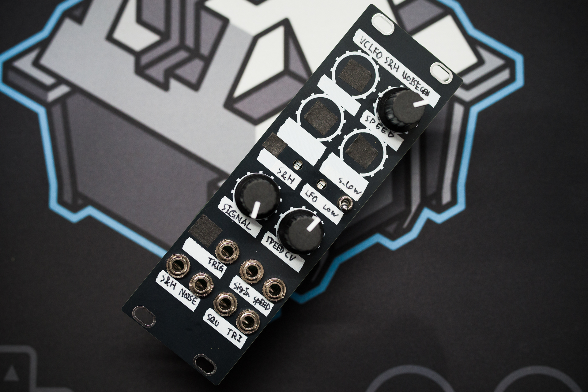
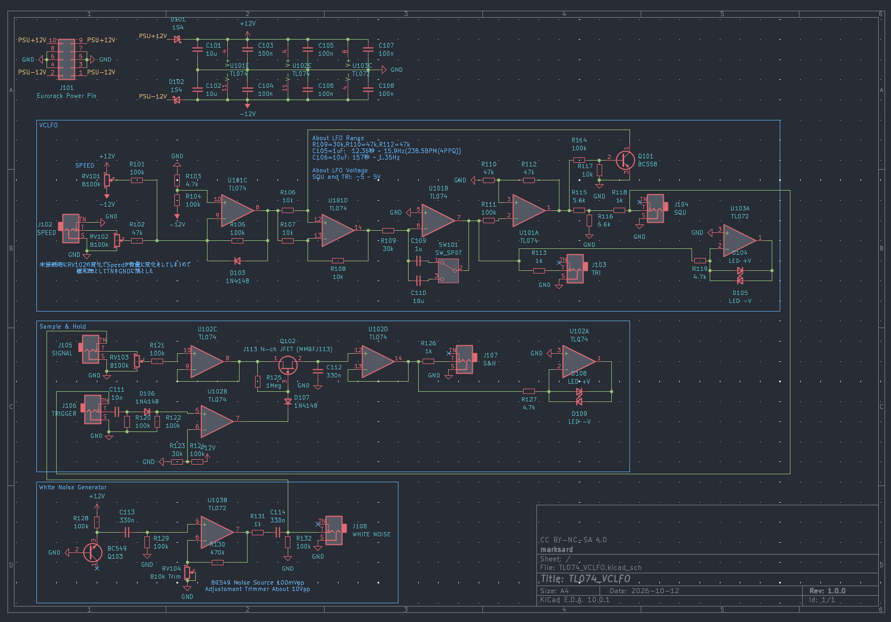
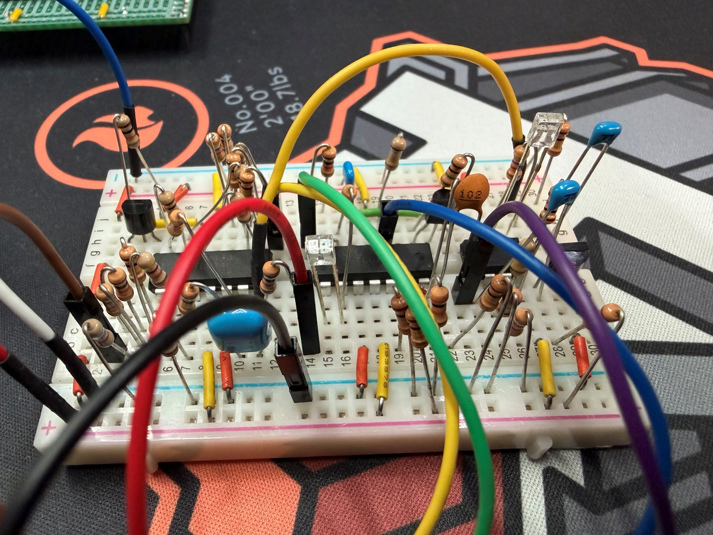
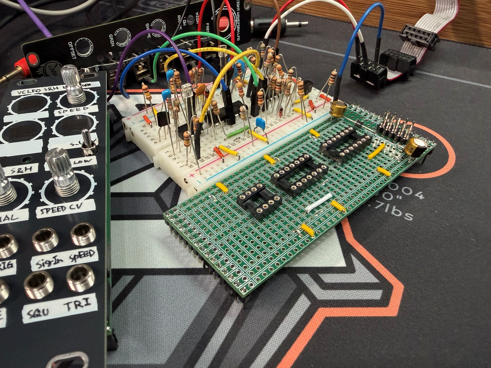
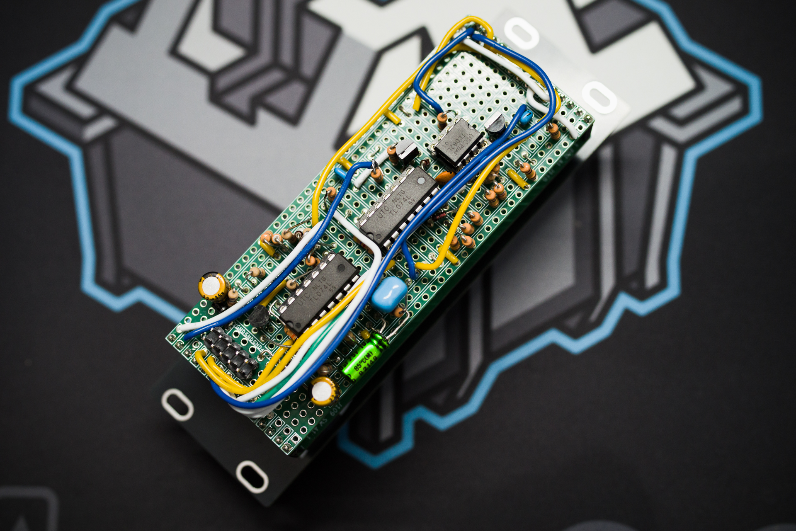

  

## やろうやろうと思いつつ放置してたやつのふたつめ

ハードウェアVCLFOを作りたいなーと思いつつ（アプリでVCFLOもクロック同期するLFOも作ったので）後回しにしてたんですけど、TL074ひとつだけのシンプルなVCLFO回路を見つけたので作ってみることにしました。で、作ってるうちにモジュラー化するため機能を足したいなとなって……  

### 回路

  

そのVCLFOは[TL074 VCO](https://tremodular.com/single-opamp-vclfo/)という回路。三角波+矩形波コアの定番LFO回路をベースにCV操作出来るように拡張されたものでTL074を1個とBC557というシンプルさ。これをベースにちょっと改造。  

* LFO周期を変更、周期選択スイッチを追加
* 出力を±5V程度に調整
* 出力確認LED回路を追加

矩形波出力、三角波出力ともバッファを入れてあげたほうがいいかもと思いつつ、DIPとスルーホール部品で組むためスペース上の制約もあって今回はそのままにしました。  

Sample & Holdは[Moritz Klein氏のyoutube動画](https://www.youtube.com/watch?v=kIJqzkRe4do)より。これもシンプルでTL074を1個とJ113だけ。これをベースにちょっと改造。  

* エッジの鈍ったトリガーも受けられるように入力キャパシタ調整
* ホワイトノイズ入力時、出力にパルスが出るのを少し抑えるためにS&Hのキャパシタ調整
* 出力確認LED回路を追加

White Noise Generatorも[Moritz Klein氏のyoutube動画](https://www.youtube.com/watch?v=0yB_h_wFkh4)より。回路は手持ちや調整の都合上ちょっとだけ変えてます。  

* 増幅率調整
* キャパシタ変更（手持ち都合）

オペアンプの増幅は100k/680+1なので約148倍。自分の個体を確認するとノイズはオシロ読みで100mVpp前後だったので470k/4.7k+1の101倍としたんですけど、Vpp値とオシロで目に見えるノイズ波形の振れ幅って結構違って…そしてS&H回路を通すと思ったほど高い電圧をホールドしない。  
振幅の大きいノイズは割合が少ないし、S&Hのキャパシタを満充電するにも足りないよな…と納得はしたものの、半固定抵抗にして調整出来るようにしておきました。  

ちなみに2SC1815互換のトランジスタを同様の回路に入れてもノイズはかなり小さかったです。  

### 組み立て

前回同様拙作の汎用ブレボ基板モジュールで作ろうと考えてて、この回路なら2つ載せても少しスペースあるから他に何か入れられそうだなー？普通のLFOを追加？波形を増やす？SYNC回路を追加する？ホワイトノイズ？S&H？いけるかな？…という感じで組み合わせて楽しそうでシンプルな回路を探して、VCLFO2個載せるのはやめてこの組み合わせになりました。  

このブレボにおさめれれば……  
  

ブレボ基板モジュールに配線をコピーして乗せ換えるだけ  
  

### 完成

拙作のブレボ基板モジュールにブレボで組み立てた回路を移動してはんだ付けして完成。パネルで使ってない部分は前回同様マステでふさいだけど、3Dプリンタでキャップみたいなの作るといいのかもな…  

  
  

### 動作確認

#### 波形

SW:LOW, POT:MAX = 16Hz  
  

SW:LOW, POT:MIN = 88.6mHz = 11.3sec  
  

SW:S.LOW, POT:MAX = 1.34Hz  
  

SW:S.LOW, POT:MIN = 6.9mHz = 144sec  
超遅くしても波形の崩れが少ない回路ですね。  
  

WHITE NOISE  
ちょっと大きめに設定しています…  
  

VCLFOの周期範囲は約2分半~16Hz(240BPM@4PPQ)に設定しました。  
そこそこ長いスパンの変化から、クロックソースとして使えるかなというレンジ。  
2分半に設定時でも波形の崩れが少ない回路ですごくいいです。  
ホワイトノイズはアタック強調のためとか、FXとかパーカス音色とかの音作りもありますが、ユーロラックだと真のランダムソースとしても使います。  
S&HはピッチCVのソース源にするとかのGATE->CV変換として、ビットクラッシュのように音色づくりに使うとか。  

またこれらを組み合わせるとランダムLFOになります。ホワイトノイズをS&Hのシグナル入力に入れて、トリガーにVCLFOの矩形波を入れて、S&Hの出力をVCLFOのSPEED CVに入れる。  
するとVCLFOの矩形波の立ち上がりでランダムな電圧がS&Hから出て、VCLFOの周波数が変化。次の矩形波の立ち上がり間隔が変わってS&Hのトリガーされる間隔も変わり…と無限ループになってて、結果ランダムなLFOになります。  

今回の回路はプラグ未接続時はS&Hのシグナル入力にホワイトノイズ、S&Hのトリガー入力にVCLFOの矩形波が入るように繋いだので、何も繋がない状態だとVCLFOの周波でランダムなS&Hが出てきます。パッチケーブルでS&Hの出力をVCLFOのSPEED CVに入れると上記のランダムLFOになります。  

このLFO出力を使って変調したり、音量変えたり、V/OCTに突っ込んでみたり、クロック代わりにしたり、音色変えたりパターン切り替えしたり…とランダム要素とパターンの収束感を調整出来て遊ぶ幅も広がります。  

ホワイトノイズの代わりにLFOやVCOを入れると周期性が生まれるし、演奏中のVCO波形を入れてもいいですね。ノイズをフィルターで削ったりするとランダム性に変化が生まれて面白いです。  

### 感想

拙作のアプリモジュールで同じ機能を持たせてあるモジュールがいくつかあるんですが、ハードウェアのみで作るとホワイトノイズは可聴域以上もフラットだし、S&Hもトリガーを可聴域レベルの周波数を入れても安定動作するので音作りに使えるし、VCLFOもヌルっと動いてて気持ちがいい。  

### デモ

前回記事と共用になりますが…  

S&Hデモ＋LFO→ランダムLFO。  
前半はS&Hのシグナル入力に3340 VCOの三角波を入れてるので、トリガーの周波数とVCOの周波数のバランスで周期性が出ています。S&Hはバイポーラ出力で出てるので、正負対応のクオンタイザー（アプリを作って）通して音階を出してます。後半はシグナル入力をホワイトノイズに切り替えてランダム演奏しています。  

<blockquote class="twitter-tweet">
VCLFO+S&amp;amp;H+NOISE GEN.モジュール出来た(中央)
40106VCO（中央左)とResonantLPG(中央右)のフィルタ+EGとを繋いで鳴らす。

正負対応のクオンタイザー(画面外)にS&amp;amp;Hを通して音程を制御。

40106の左のVCOをS&amp;amp;Hソースにして、後半は外してノイズでS&amp;amp;H。

#diyeurorack https://t.co/o8mfF3UBEK
&mdash; 𓊬 ᙢᗩᖇḰ 𓊬 (@marksard) <a href="https://x.com/marksard/status/2112744779230613913?ref_src=twsrc%5Etfw">October 21, 2026</a></blockquote>

こちらはVCLFOをクロックソースに、ClockDivでS&HやEGのトリガータイミングを調整してフレーズを作っています。  

<blockquote class="twitter-tweet">
最近作った組で遊んでる
ClockDiv+GateORでトリガーパターンを作ったりS&amp;amp;Hのホールドタイミングを変えたりS&amp;amp;Hに流し込むVCOの周波数変えたりしてフレーズに変化を与えて遊ぶ
#diyeurorack https://t.co/HXve4P9ARR
&mdash; 𓊬 ᙢᗩᖇḰ 𓊬 (@marksard) <a href="https://x.com/marksard/status/2114202055531471309?ref_src=twsrc%5Etfw">October 25, 2026</a></blockquote>

